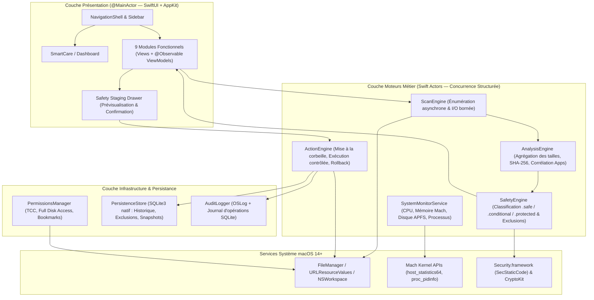

# 05 — Architecture Technique Détaillée de MacCare

> **Projet** : MacCare  
> **Mission** : Mission 01 — Phase E (Architecture technique native macOS)  
> **Environnement de développement vérifié** : macOS 14.8.3 (`23J220`), Mac Intel `x86_64`, Xcode 16.1 (`16B40`), Apple Swift 6.0.2.  
> **Cible de déploiement** : Binaire Universel (`ARCHS = "x86_64 arm64"`), `MACOSX_DEPLOYMENT_TARGET = 14.0`.

---

## 1. Principes Architecturaux Fondamentaux

1. **100 % Natif macOS (Swift + SwiftUI + AppKit)** : Aucune couche Web, aucun Electron, aucune dépendance lourde non nécessaire. Empreinte mémoire minimale et intégration directe avec les API système d'Apple.
2. **Séparation stricte Interface / Moteurs (*Zero Direct File Mutation from UI*)** : Aucune vue SwiftUI ni aucun `ViewModel` n'appelle jamais `FileManager.removeItem` ou `FileManager.trashItem`. Toute action passe par un pipeline unidirectionnel auditable :
   `ScanEngine` -> `AnalysisEngine` -> `SafetyEngine` -> `StagingQueue` (Validation Utilisateur) -> `ActionEngine` -> `AuditLog (SQLite)`.
3. **Concurrence structurée (`Swift Concurrency`)** : Utilisation d'`actor` pour isoler l'état des moteurs de scan, de la file de staging et de la base SQLite, et d'`AsyncThrowingStream` pour diffuser la progression en temps réel vers l'interface sans bloquer le `@MainActor`.
4. **Aucun Helper Privilégié (`root`) au Démarrage** : MacCare fonctionne avec les privilèges de l'utilisateur courant. Cette décision élimine les risques d'escalade de privilèges locale (CVE fréquentes sur les helpers XPC mal validés) et couvre plus de 90 % des besoins réels de nettoyage (`~/Library/Caches`, `~/Library/Logs`, `DerivedData`, `~/Downloads`, `~/.Trash`, `~/Library/LaunchAgents`, désinstallation d'apps utilisateur).

---

## 2. Vue d'Ensemble de l'Architecture en Couches



---

## 3. Responsabilités Détaillées par Composant

### 3.1. Couche Interface & Navigation (`Sources/App`, `Sources/DesignSystem`, `Sources/Navigation`)
- **`MacCareApp`** : Point d'entrée SwiftUI (`WindowGroup` principal + scène `Settings`).
- **`NavigationCoordinator` (`@Observable @MainActor`)** : Gère la sélection parmi les 9 modules de la barre latérale (`NavigationSplitView`), l'état d'occupation global des tâches en cours et l'ouverture du tiroir de prévisualisation (*Safety Staging Drawer*).
- **`DesignSystem`** :
  - Jetons de couleurs adaptatifs Dark/Light (`MacCarePalette`), typographie tabulaire (`MacCareTypography`), badges de sécurité (`SafetyBadgeView`), cartes Bento (`MetricCardView`), jauges et graphiques (`Swift Charts`), et intégration AppKit (`QuickLookPreviewRepresentable`, `FinderRevealButton`).

### 3.2. Moteur de Scan (`Sources/Core/Scanner/ScanEngine.swift`)
- Implémenté sous forme d'`actor` coordonnant des tâches bornées (`withThrowingTaskGroup`, parallélisme limité à 4-6 tâches d'I/O simultanées pour préserver la réactivité sur Mac Intel et SSD APFS).
- Lit uniquement les clés `URLResourceKey` strictement nécessaires en un seul appel système (`getattrlistbulk` sous-jacent à `FileManager.enumerator(at:includingPropertiesForKeys:)`) :
  - `.isRegularFileKey`, `.isDirectoryKey`, `.isSymbolicLinkKey`, `.isPackageKey`
  - `.totalFileAllocatedSizeKey`, `.fileAllocatedSizeKey`, `.fileSizeKey`
  - `.contentModificationDateKey`, `.contentAccessDateKey`
  - `.volumeIdentifierKey`, `.fileResourceIdentifierKey`
  - `.ubiquitousItemDownloadingStatusKey` (pour exclure les fichiers iCloud non présents localement).
- Vérifie `Task.checkCancellation()` à chaque répertoire parcouru pour garantir un arrêt quasi instantané (`< 100 ms`).

### 3.3. Moteur d'Analyse et de Classification (`Sources/Core/Analyzer/AnalysisEngine.swift`)
- **Agrégation hiérarchique** : Construit l'arbre de stockage en temps quasi linéaire et calcule les totaux par dossier parent.
- **Pipeline de doublons en 3 passes** :
  1. Filtre par taille identique (`> 0` octet) et `fileResourceIdentifierKey` distinct (ignore les hardlinks APFS pointant vers le même inode).
  2. Empreinte rapide `SHA256` sur les premiers `32 Ko` + derniers `32 Ko` (lecture via `FileHandle.seek`).
  3. Empreinte complète `CryptoKit.SHA256` par blocs de `1 Mo` en lecture séquentielle.
- **Corrélation d'applications (`AppBundleCorrelator`)** :
  - Extrait `CFBundleIdentifier`, `CFBundleName` et les groupes d'applications (`com.apple.security.application-groups`) d'un `.app` et recherche par correspondance exacte ou préfixe contrôlé dans `~/Library/Application Support`, `~/Library/Caches`, `~/Library/Preferences`, `~/Library/Containers`, `~/Library/Saved Application State` et `~/Library/Logs`.

### 3.4. Moteur de Sécurité (`Sources/Core/Safety/SafetyEngine.swift`)
- Évalue chaque `ScanCandidate` contre trois listes :
  1. **`SystemProtectionRules` (Inviolable, codée en dur)** : Bloque `/System`, `/usr`, `/bin`, `/sbin`, `/private/var/db`, `~/Library/Keychains`, `~/Library/Application Support/com.apple.TCC`, `~/Library/Mail` (hors `Mail Downloads` explicite), `~/Library/Messages`, `~/Pictures/Photos Library.photoslibrary`, `.git`, bases `.sqlite`/`.db` non listées comme caches purs.
  2. **`ActiveProcessGuard`** : Interroge `NSWorkspace.shared.runningApplications` ; tout cache ou support appartenant à une application actuellement ouverte est déclassé ou verrouillé tant que l'application tourne.
  3. **`UserExclusionStore`** : Liste d'exclusions personnalisées persistée dans SQLite (chemins, dossiers ou identifiants de bundles ignorés par l'utilisateur).

### 3.5. Moteur d'Opérations et de Nettoyage (`Sources/Core/FileOperations/ActionEngine.swift`)
- **Exécution en deux phases obligatoires** :
  1. **Préparation (`StagingPlan`)** : Génère un plan immuable contenant la liste exacte des URLs, leur taille vérifiée, le mode d'action (`.moveToTrash` par défaut, `.deleteTrashItem` uniquement depuis le module Corbeille) et le contrôle de pré-vol (`SafetyEngine.validate(plan)`).
  2. **Exécution (`execute(plan:)`)** :
     - Utilise `FileManager.default.trashItem(at:resultingItemURL:)` par défaut et enregistre le couple `(originalPath, trashedPath, sizeBytes, timestamp)` dans la base SQLite pour permettre une **restauration assistée**.
     - Gère les erreurs fichier par fichier (un fichier verrouillé n'interrompt pas le lot complet ; il est consigné dans le rapport d'exécution avec la raison POSIX/Cocoa précise).

### 3.6. Surveillance Système (`Sources/Core/SystemMonitor/`)
- **CPU** : Appel Mach `host_processor_info(mach_host_self(), PROCESSOR_CPU_LOAD_INFO, ...)` comparant les ticks `CPU_STATE_USER`, `CPU_STATE_SYSTEM`, `CPU_STATE_NICE` et `CPU_STATE_IDLE` entre deux échantillons.
- **Mémoire (RAM)** : Appel Mach `host_statistics64(mach_host_self(), HOST_VM_INFO64, ...)` retournant `active_count`, `wire_count`, `compressor_page_count`, `free_count`, `external_page_count` multipliés par `vm_kernel_page_size`.
- **Processus** : `NSWorkspace.shared.runningApplications` combiné à `proc_listpids` / `proc_pidinfo(..., PROC_PIDTASKINFO, ...)` et `proc_pid_rusage` pour obtenir l'empreinte mémoire réelle (`ri_phys_footprint`) et le temps CPU des processus appartenant à l'utilisateur.

### 3.7. Persistance Locale (`Sources/Core/Persistence/DatabaseManager.swift`)
- Utilisation directe de la bibliothèque système **`SQLite3` (`import SQLite3`)** présente nativement dans macOS (`/usr/lib/libsqlite3.dylib`), encapsulée dans un `actor DatabaseManager` léger et typé (zéro dépendance externe fragile).
- Emplacement de la base : `~/Library/Application Support/MacCare/maccare.sqlite` (mode `WAL` activé).
- **4 tables principales** :
  1. `scan_sessions` : Historique des analyses (date, module, durée, octets détectés).
  2. `action_logs` : Journal d'audit complet des opérations (id, session_id, timestamp, action_type, original_path, trashed_path, bytes_freed, status, error_message).
  3. `exclusion_rules` : Chemins et `bundle_id` exclus par l'utilisateur.
  4. `startup_backups` : Sauvegarde du contenu et du chemin des fichiers `LaunchAgents` désactivés par l'utilisateur.

---

## 4. Structure Cible du Projet Xcode (`MacCare/`)

Au vu des outils installés sur la machine (`Xcode 16.1`, `Swift 6.0.2`), nous recommandons une structure hybride propre : **un projet Xcode d'application macOS (`MacCare.xcodeproj`)** s'appuyant sur des dossiers de sources modulaires clairement séparés :

```text
MacCare/
├── MacCare.xcodeproj
├── Package.swift                      (Optionnel/Complémentaire : permet d'exécuter `swift test` rapidement sur le Core)
├── Sources/
│   ├── App/
│   │   ├── MacCareApp.swift
│   │   └── AppCommands.swift
│   ├── DesignSystem/
│   │   ├── Theme/                     (MacCarePalette, MacCareTypography, Spacing)
│   │   └── Components/                (MetricCard, SafetyBadge, StorageBar, StagingDrawer)
│   ├── Navigation/
│   │   ├── AppModule.swift
│   │   ├── NavigationCoordinator.swift
│   │   └── MainSplitView.swift
│   ├── Dashboard/                     (Vue d'ensemble & état global)
│   ├── Features/
│   │   ├── SmartCare/                 (Module 01)
│   │   ├── SystemJunk/                (Module 02)
│   │   ├── StorageAnalyzer/           (Module 03)
│   │   ├── AppManager/                (Module 04)
│   │   ├── DuplicateFinder/           (Module 05)
│   │   ├── Performance/               (Module 06)
│   │   ├── StartupManager/            (Module 07)
│   │   ├── Maintenance/               (Module 08)
│   │   ├── Protection/                (Module 09)
│   │   └── Settings/                  (Préférences, Exclusions, Historique d'audit)
│   ├── Core/
│   │   ├── Models/                    (ScanItem, SafetyLevel, ActionPlan, SystemMetrics)
│   │   ├── Scanner/                   (ScanEngine, FileEnumerator, DiskSpaceService)
│   │   ├── Analyzer/                  (AnalysisEngine, DuplicateHasher, AppCorrelator)
│   │   ├── Safety/                    (SafetyEngine, ProtectedPaths, ActiveProcessGuard)
│   │   ├── FileOperations/            (ActionEngine, StagingQueue, TrashService)
│   │   ├── SystemMonitor/             (MachMetricsService, ProcessInspector, SecurityPostureService)
│   │   ├── Permissions/               (PermissionsManager, FullDiskAccessDetector)
│   │   └── Persistence/               (DatabaseManager, AuditLogger, ExclusionRepository)
│   └── Resources/
│       ├── Assets.xcassets
│       ├── Info.plist
│       └── MacCare.entitlements
├── Tests/
│   ├── UnitTests/
│   │   ├── SafetyEngineTests.swift
│   │   ├── DuplicateHasherTests.swift
│   │   ├── ActionEngineTests.swift
│   │   └── DatabaseManagerTests.swift
│   └── IntegrationTests/
│       └── SandboxScanIntegrationTests.swift
├── Documentation/
│   ├── 01-reference-audit.md
│   ├── 02-feature-inventory.md
│   ├── 03-ui-analysis.md
│   ├── 04-product-requirements.md
│   ├── 05-technical-architecture.md
│   ├── 06-security-model.md
│   └── 07-roadmap.md
└── README.md
```

---

## 5. Évaluation des Contraintes macOS : Sandboxing, TCC, Signature et Distribution

1. **Distribution Hors Mac App Store (Recommandée)** :
   - Un outil natif d'analyse et de maintenance système complet doit pouvoir inspecter `~/Library/Caches`, `~/Library/Logs`, `~/Library/Application Support` et `~/Library/LaunchAgents` dans l'espace utilisateur.
   - Nous recommandons donc une application **Hardened Runtime (`ENABLE_HARDENED_RUNTIME = YES`) sans App Sandbox**, distribuée en image disque `.dmg` signée avec **Developer ID Application** et **notarisée par Apple (`notarytool`)**.
2. **Compatibilité Universelle (`x86_64` & `arm64`)** :
   - Sur le Mac actuel (`Intel x86_64`, macOS `14.8.3`, Xcode `16.1`), Xcode compile nativement les deux tranches (`ARCHS = "x86_64 arm64"`) sans aucune dépendance externe spécifique à une architecture.
   - Toutes les API retenues (`SwiftUI`, `Swift Charts`, `Observation` `@Observable`, `FileManager`, `CryptoKit`, `SQLite3`, `Mach` APIs) sont 100 % disponibles et stables dès **macOS 14.0 (Sonoma)**.
