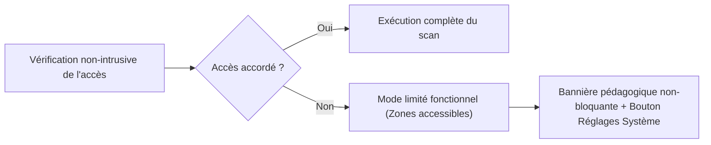

# 06 — Modèle de Sécurité, Permissions et Limites de macOS

> **Projet** : MacCare  
> **Mission** : Mission 01 — Exigences de sécurité et gouvernance des opérations  
> **Principe cardinal** : *En cas de doute sur la nature d'un fichier ou d'un processus, MacCare s'abstient de toute modification et classe l'élément en `.protected`.*

---

## 1. Les 10 Règles d'Or de Sécurité de MacCare

1. **Zéro nettoyage automatique silencieux** : Aucune analyse (y compris *Smart Care*) ne déclenche jamais de suppression sans passage explicite par l'écran de prévisualisation et clic de confirmation de l'utilisateur.
2. **Inviolabilité des fichiers système** : Aucun fichier situé sous `/System`, `/usr` (hors `/usr/local` si explicitement inspecté en lecture seule), `/bin`, `/sbin` ou `/private/var/db` n'est jamais proposé à la suppression.
3. **Respect absolu de SIP et TCC** : MacCare ne tente jamais de contourner *System Integrity Protection* (SIP), ne modifie jamais les bases `TCC.db` et n'utilise aucune API privée ou exploit système.
4. **Intégrité des Bundles Applicatifs Signés** : Contrairement aux anciens nettoyeurs qui supprimaient des fichiers `.lproj` ou des tranches binaires (`lipo`) à l'intérieur des `.app`, **MacCare n'altère jamais l'intérieur d'un bundle `.app` installé**, car cela brise la signature cryptographique (`CodeSignature`) et empêche l'application de se lancer sous macOS 14+.
5. **Exclusion par défaut des bases de données et documents sensibles** : Les fichiers `.sqlite`, `.sqlite3`, `.db`, `.storedata`, `.keychain`, `.keychain-db`, `.photoslibrary`, `.musiclibrary` et les dépôts `.git` en dehors des dossiers de cache pur identifiés sont exclus par défaut.
6. **Protection des applications en cours d'exécution** : Avant de nettoyer le cache ou de désinstaller une application, MacCare vérifie si le bundle est actif dans `NSWorkspace.shared.runningApplications`. Si oui, l'élément est verrouillé ou MacCare propose de fermer proprement l'application au préalable.
7. **Garantie « Au moins un original » sur les doublons** : Dans le module *Duplicate Finder*, le moteur d'interface et le `SafetyEngine` interdisent structurellement de sélectionner la totalité des exemplaires d'un même groupe d'empreinte `SHA-256` sans une double confirmation explicite.
8. **Priorité à la Corbeille (`FileManager.trashItem`)** : Toutes les suppressions de fichiers utilisateur, de restes d'applications, de doublons et de caches passent par défaut par la mise à la Corbeille macOS, offrant un filet de sécurité natif.
9. **Traçabilité et Journalisation SQLite Exhaustive** : Chaque opération (heure, chemin source, chemin dans la corbeille, taille libérée, résultat ou erreur) est enregistrée dans `maccare.sqlite` et consultable à tout moment dans l'interface.
10. **Honnêteté technique (Performances & Sécurité)** :
    - Pas de faux « optimiseur magique de RAM » qui alloue de la mémoire de force au détriment du swap SSD.
    - Pas de fausse promesse d'antivirus complet : le module *Protection* documente clairement qu'il effectue un contrôle de posture macOS (SIP, Gatekeeper, FileVault, XProtect), de signatures `codesign` et de quarantaine.

---

## 2. Matrice de Classification et Chemins Système (`SafetyEngine`)

### 2.1. Chemins Strictement Protégés (`.protected` — Liste Noire Inviolable)
Toute URL correspondant à l'un des préfixes ou motifs suivants est rejetée au niveau du `SafetyEngine` avant même de pouvoir entrer dans un `StagingPlan` :
- `/System/**`, `/bin/**`, `/sbin/**`, `/usr/bin/**`, `/usr/lib/**`, `/usr/libexec/**`
- `/Library/Apple/**`, `/Library/Extensions/**`, `/Library/SystemExtensions/**`
- `/private/var/db/**`, `/private/var/root/**`, `/private/etc/**`
- `~/Library/Keychains/**`
- `~/Library/Application Support/com.apple.TCC/**`
- `~/Library/Application Support/MobileSync/Backup/**` *(sauf inspection dédiée en lecture seule avec avertissement explicite)*
- `~/Library/Mail/**` *(à l'exception stricte du sous-dossier de téléchargements temporaires `Mail Downloads` en mode `.conditional`)*
- `~/Library/Messages/**`, `~/Library/Safari/Bookmarks.plist`, `~/Library/Safari/History.db`
- Tout dossier contenant un répertoire `.git/` ou `.svn/` (protection des projets de développement).

### 2.2. Chemins Admissibles en « Nettoyage Sûr » (`.safe`)
- `~/Library/Caches/<bundle-id>/**` (uniquement pour les applications tierces ou caches non critiques dont l'application est fermée).
- `~/Library/Logs/**` et `~/Library/Logs/DiagnosticReports/*.ips` (journaux de plus de 7 jours).
- `~/Library/Saved Application State/*.savedState/**` (pour les applications fermées).

### 2.3. Chemins Admissibles en « Nettoyage Conditionnel » (`.conditional` — Décochés par défaut)
- `~/Library/Developer/Xcode/DerivedData/**`
- `~/Library/Developer/Xcode/iOS DeviceSupport/**`
- `~/Library/Caches/Homebrew/**`, `~/.npm/_cacache/**`
- `~/.Trash/**` (Vidage de la corbeille)
- Fichiers volumineux/anciens et doublons dans `~/Downloads`, `~/Documents`, `~/Desktop` (sélection 100 % manuelle).

---

## 3. Gestion Propre des Permissions macOS (TCC & Full Disk Access)

macOS 14 applique le modèle **TCC (*Transparency, Consent, and Control*)**. MacCare gère les autorisations selon trois principes :

1. **Détection non-intrusive de l'Accès Complet au Disque (*Full Disk Access*)** :
   - Pour savoir si *Full Disk Access* est accordé sans déclencher de popups intempestifs, MacCare teste la lisibilité d'un répertoire témoin protégé par TCC dans le dossier utilisateur (ex. `FileManager.default.isReadableFile(atPath: NSHomeDirectory() + "/Library/Safari")`).
2. **Fonctionnement garanti en Mode Limité** :
   - Si l'utilisateur n'accorde pas l'Accès complet au disque, **MacCare ne bloque jamais l'interface** : il analyse normalement les dossiers accessibles (`~/Library/Caches` publics, `~/Library/Logs`, `/Applications`, métriques CPU/RAM, `~/Library/LaunchAgents`) et affiche un badge discret indiquant quelles zones supplémentaires pourraient être analysées avec l'Accès complet au disque.
3. **Sélecteur de dossier natif (`NSOpenPanel`)** :
   - Dans *Storage Analyzer* et *Duplicate Finder*, l'utilisateur peut choisir n'importe quel dossier via `NSOpenPanel`, ce qui accorde automatiquement et proprement le droit de lecture à MacCare via *Powerbox / TCC User Intent* sans même nécessiter l'Accès complet au disque.
4. **Guidage vers les Réglages Système** :
   - Lorsqu'une permission est souhaitée, MacCare explique en une phrase claire pourquoi elle est demandée et propose un bouton ouvrant directement la rubrique correspondante :
     `x-apple.systempreferences:com.apple.preference.security?Privacy_AllFiles`.

---

## 4. Protocole de Prévisualisation, Exécution et Annulation (*Staging & Rollback*)

Avant toute opération modifiant le système de fichiers :
1. **Panneau de Préparation (*Staging Drawer*)** :
   - Affiche le nombre exact de fichiers, le volume total en Mo/Go, la répartition par catégorie de risque (`.safe` vs `.conditional`) et la liste complète des chemins.
2. **Vérification Pré-Exécution (*Pre-flight Check*)** :
   - Au moment où l'utilisateur confirme, `ActionEngine` re-vérifie que chaque fichier existe toujours, n'est pas un lien symbolique pointant vers une zone protégée (protection contre les attaques *TOCTOU / symlink race*) et que l'application propriétaire n'a pas été lancée entre-temps.
3. **Mise à la Corbeille & Restauration** :
   - En utilisant `FileManager.default.trashItem(at:resultingItemURL:)`, MacCare récupère l'URL exacte du fichier dans `~/.Trash` et l'enregistre dans la table `action_logs` de SQLite.
   - Depuis l'écran **Historique des opérations**, l'utilisateur peut cliquer sur **Restaurer à l'emplacement d'origine** tant que la Corbeille n'a pas été vidée : MacCare déplace alors l'élément de `trashed_path` vers `original_path`.
