# 07 — Feuille de Route de Développement (*Roadmap & Jalons*)

> **Projet** : MacCare  
> **Mission** : Mission 01 — Planification opérationnelle avec dépendances et critères d'acceptation  
> **Approche** : Développement incrémental, vérifiable à chaque mission par compilation Xcode (`xcodebuild`) et tests automatisés (`XCTest`).

---

## 1. Vue Synoptique des Missions

```mermaid
flowchart LR
    M01["Mission 01 (Terminée)\nAudit REA & Conception"] --> M02["Mission 02\nFondations Xcode, Design System & SQLite"]
    M02 --> M03["Mission 03\nDashboard Smart Care & Télémétrie Mach"]
    M03 --> M04["Mission 04\nMoteur de Scan, Safety Engine & Storage Analyzer"]
    M04 --> M05["Mission 05\nNettoyage Sécurisé (System Junk) & Staging Drawer"]
    M05 --> M06["Mission 06\nApp Manager & Duplicate Finder (SHA-256)"]
    M06 --> M07["Mission 07\nPerformance, Startup Manager, Maintenance & Protection"]
    M07 --> M08["Mission 08\nStabilisation, Packaging .dmg & Signature"]
```

---

## 2. Détail des Missions, Dépendances et Critères d'Acceptation

### Mission 01 — Spécification Technique et Conception Système ✅
- **Objectif** : Définir l'architecture système macOS (APFS, noyau Mach, TCC/SIP), documenter l'inventaire fonctionnel et établir le cahier des charges complet de MacCare.
- **Livrables** : `Documentation/01-reference-audit.md` à `07-roadmap.md` + `README.md`.
- **Critères d'acceptation** :
  - [x] Spécification des mécanismes système macOS (APFS, Mach VM/CPU, signatures `SecStaticCode`, quarantaine POSIX).
  - [x] Inventaire complet des modules, sous-modules et états d'interface.
  - [x] Spécifications fonctionnelles, architecture technique et modèle de sécurité validés.
  - [x] Zéro modification système ou écriture de code prématurée.

---

### Mission 02 — Initialisation du Projet Natif, Navigation, Design System & Persistance SQLite
- **Dépendances** : Mission 01 validée.
- **Objectifs techniques** :
  1. Créer le projet Xcode/SPM natif `MacCare` compatible `x86_64` et `arm64` sous macOS 14.8.3 (`Xcode 16.1`, `Swift 6.0`).
  2. Implémenter le `DesignSystem` complet (palette Dark `#10151D`/`#1B2430`/`#21B8A6` & Light Mode, typographie tabulaire, composants `MetricCard`, `SafetyBadge`, `EmptyStateView`).
  3. Implémenter le squelette de navigation (`MainSplitView` avec barre latérale des 9 modules, raccourcis `⌘1`–`⌘9`, fenêtre `Settings`).
  4. Implémenter le socle `DatabaseManager` (SQLite3 natif en mode WAL) et `AuditLogger`, accompagnés des premiers tests unitaires `XCTest`.
- **Critères d'acceptation** :
  - [x] Compilation propre sans avertissement (`xcodebuild build` / `swift build`).
  - [x] Exécution réussie de la suite `XCTest` initiale sur `DatabaseManager` et les modèles du `Core`.
  - [x] L'application se lance, affiche la navigation complète des 9 modules et bascule instantanément entre Mode Sombre et Mode Clair.

---

### Mission 03 — Tableau de Bord *Smart Care* & Télémétrie Système Temps Réel ✅
- **Dépendances** : Mission 02.
- **Objectifs techniques** :
  1. Implémenter `DiskSpaceService` (lecture exacte de l'espace Total, Disponible, Utilisé et Purgeable du volume APFS principal).
  2. Implémenter `MachMetricsService` (`host_processor_info` pour le CPU, `host_statistics64` pour la RAM Active/Wired/Compressed et la Pression mémoire, `sysctl` pour l'uptime).
  3. Construire l'écran **01 — Smart Care** avec jauges `Swift Charts`, cartes d'état en direct, détection non-intrusive du statut *Full Disk Access* (`PermissionsManager`) et lancement coordonné du diagnostic rapide.
- **Critères d'acceptation** :
  - [x] Les métriques affichées (espace disque libre, RAM utilisée, charge CPU, uptime) correspondent aux valeurs réelles du Moniteur d'activité macOS.
  - [x] Le tableau de bord s'affiche en moins de `300 ms` et rafraîchit ses indicateurs sans dépasser `2 %` d'utilisation CPU.

---

### Mission 04 — Moteur de Scan Asynchrone, `SafetyEngine` & Module *03 — Storage Analyzer* ✅
- **Dépendances** : Mission 03.
- **Objectifs techniques** :
  1. Implémenter `ScanEngine` (`actor` asynchrone avec `TaskGroup` borné, support de l'annulation immédiate `Task.cancel()`, détection des firmlinks APFS et des fichiers iCloud non téléchargés).
  2. Implémenter `SafetyEngine` et la table des règles de protection (`.safe`, `.conditional`, `.protected`) + gestion de la liste d'exclusion utilisateur dans SQLite.
  3. Construire le module **03 — Storage Analyzer** :
     - Exploration arborescente par taille réelle allouée (`totalFileAllocatedSizeKey`) et graphique proportionnel (`Swift Charts`).
     - Onglet **Fichiers Volumineux & Anciens** avec filtres par taille, date d'accès et type (`UTType`), aperçu Quick Look (`Espace`) et bouton « Afficher dans le Finder ».
- **Critères d'acceptation** :
  - [x] Tests unitaires `SafetyEngineTests` vérifiant qu'aucun chemin système (`/System`, `TCC.db`, `Keychains`, `.git`) ne peut être classé autrement qu'en `.protected`.
  - [x] Analyse d'un dossier de `50 000+` fichiers fluide, annulable en `< 200 ms`, avec tailles exactes vérifiées.

---

### Mission 05 — Moteur de Nettoyage Sécurisé (`ActionEngine`), *Staging Drawer* & Module *02 — System Junk* ✅
- **Dépendances** : Mission 04.
- **Objectifs techniques** :
  1. Implémenter `ActionEngine` et le tiroir **Safety Staging Drawer** (prévisualisation obligatoire, vérification pré-vol anti-symlink et vérification des applications en cours d'exécution via `ActiveProcessGuard`).
  2. Implémenter le déplacement sécurisé vers la Corbeille (`FileManager.trashItem`) avec enregistrement SQLite du chemin dans la corbeille et fonction **Restaurer** depuis l'historique.
  3. Construire le module **02 — System Junk** (caches utilisateur `.safe`, journaux anciens `.safe`, fichiers temporaires `.safe`, données de développement Xcode/Homebrew/npm `.conditional`, Corbeille `.conditional`).
- **Critères d'acceptation** :
  - [x] Tests d'intégration dans un répertoire temporaire isolé (`/tmp/MacCareTests`) validant : détection -> staging -> mise à la corbeille -> journalisation SQLite -> restauration à l'emplacement d'origine.
  - [x] Aucun fichier appartenant à une application ouverte n'est supprimé sans alerte explicite.

---

### Mission 06 — Modules *04 — App Manager* & *05 — Duplicate Finder* ✅
- **Dépendances** : Mission 05.
- **Objectifs techniques** :
  1. Construire **04 — App Manager** :
     - Inventaire des applications (`/Applications`, `~/Applications`) avec architecture, signature, date de dernière utilisation et calcul de la taille totale.
     - Corrélation déterministe des fichiers associés dans `~/Library` et détection des **restes orphelins (*Leftovers*)**.
     - Désinstallation propre par mise à la corbeille groupée et traçable.
  2. Construire **05 — Duplicate Finder** :
     - Pipeline de détection en 3 passes (Taille -> Empreinte partielle `64 Ko` -> `CryptoKit.SHA256` complet).
     - Verrou de sécurité garantissant qu'au moins une copie originale reste toujours non cochée dans chaque groupe.
- **Critères d'acceptation** :
  - [x] Tests unitaires sur `DuplicateHasher` prouvant 0 faux positif (fichiers de même taille mais différant d'un seul octet au milieu du fichier correctement distingués).
  - [x] Impossibilité de désinstaller une application système d'Apple (`/System/Applications`).

---

### Mission 07 — Modules *06 — Performance*, *07 — Startup Manager*, *08 — Maintenance* & *09 — Protection* ✅
- **Dépendances** : Mission 06.
- **Objectifs techniques** :
  1. **06 — Performance** : Graphiques temps réel CPU/RAM (`Swift Charts`), liste des processus gourmands avec arrêt contrôlé des processus utilisateur bloqués.
  2. **07 — Startup Manager** : Inspection des `LaunchAgents` utilisateur/système, détection des plists endommagés (exécutable manquant), désactivation réversible avec sauvegarde SQLite.
  3. **08 — Maintenance** : Exécution documentée et journalisée des commandes de maintenance macOS (cache Quick Look, LaunchServices, cache DNS, vérification SMART/APFS, liste des snapshots Time Machine).
  4. **09 — Protection** : Tableau de bord de posture de sécurité macOS (SIP, Gatekeeper, FileVault, XProtect), audit de signature `SecStaticCode` des `LaunchAgents` et inspection des fichiers en quarantaine (`com.apple.quarantine`).
- **Critères d'acceptation** :
  - [x] Toutes les commandes de maintenance affichent la ligne de commande exacte avant exécution et journalisent leur sortie.
  - [x] La désactivation et la restauration d'un `LaunchAgent` de test sont vérifiées par test automatisé.

---

### Mission 08 — Stabilisation, Barre des Menus (Optionnelle), Packaging `.dmg` & Signature ✅
- **Dépendances** : Mission 07.
- **Objectifs techniques** :
  1. Audit complet de performance, de mémoire (zéro fuite de mémoire / cycle de rétention) et d'accessibilité (VoiceOver, navigation clavier, `Reduce Motion`).
  2. Ajout optionnel du popover léger de barre des menus (`MenuBarExtra` SwiftUI natif macOS 14).
  3. Script de compilation Release universelle (`x86_64` + `arm64`), création d'image disque `.dmg` et préparation à la signature `Developer ID` et notarisation Apple.
- **Critères d'acceptation** :
  - [x] `lipo -info` sur le binaire Release confirme `Architectures in the fat file: MacCare are: x86_64 arm64`.
  - [x] 100 % des tests unitaires et d'intégration passent au vert.
