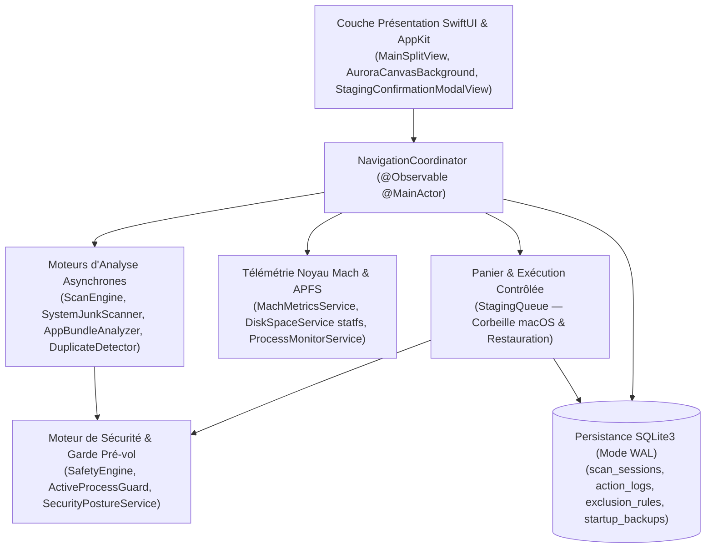

<div align="center">


# MacCare

**Application native macOS open-source de maintenance, d'analyse de stockage APFS, de télémétrie noyau Mach et de sécurité.**  
*Conçue en Swift, SwiftUI, AppKit, Swift Charts, SQLite3 et CryptoKit — Binaire universel (`x86_64` & `arm64`) pour macOS 14+ (Sonoma / Sequoia).*

[](https://github.com/lph2o/MacCare/releases/latest/download/MacCare-Universal.dmg)
[-MacCare--Universal.zip-845EC2?style=for-the-badge&logo=apple&logoColor=white)](https://github.com/lph2o/MacCare/releases/latest/download/MacCare-Universal.zip)

[-0D0E17?style=flat-square&logo=apple&logoColor=white)](#)
[](#)
[](#)
[](./LICENSE)

</div>

---

## Téléchargement & Installation Rapide (Sans aucune compétence technique)

Vous n'avez **pas besoin** d'utiliser le Terminal ni de compiler le code pour installer **MacCare** sur votre Mac :

1. **Téléchargez l'installateur** en cliquant directement sur l'un des liens suivants :
   - [**Télécharger `MacCare-Universal.dmg` (Recommandé — Image disque macOS)**](https://github.com/lph2o/MacCare/releases/latest/download/MacCare-Universal.dmg)
   - [**Télécharger `MacCare-Universal.zip` (Archive directe `.app`)**](https://github.com/lph2o/MacCare/releases/latest/download/MacCare-Universal.zip)
   - Ou consultez la page des [**Versions officielles (GitHub Releases)**](https://github.com/lph2o/MacCare/releases/latest).
2. **Installez en un glisser-déposer** : Double-cliquez sur `MacCare-Universal.dmg` et faites glisser l'icône **MacCare** dans le dossier **Applications**.
3. **Lancez MacCare** depuis votre dossier **Applications** ou le Launchpad.
   > *Astuce premier lancement (macOS Gatekeeper)* : Comme **MacCare** est une application 100 % gratuite et open-source distribuée hors Mac App Store, si macOS affiche un message de sécurité lors de la toute première ouverture, faites simplement **Clic droit (ou Ctrl + Clic) sur MacCare → Ouvrir**, puis cliquez sur **Ouvrir**.

---

## Présentation

**MacCare** est une suite native de maintenance, d'optimisation et d'analyse système pour macOS dotée d'une interface **Glassmorphic Aurora** fluide et d'une architecture 100 % transparente, vérifiable et respectueuse des mécanismes de sécurité d'Apple (**SIP**, **TCC**, **Gatekeeper**, **XProtect**, **APFS Firmlinks**).

Contrairement aux outils propriétaires opaques, **MacCare** n'impose aucun démon `root` permanent en arrière-plan, n'altère jamais l'intérieur des bundles `.app` signés par des tiers, et qualifie chaque fichier par un moteur de sécurité déterministe avant toute opération.

---

## Engagements de Sécurité & Transparence

1. **Explicabilité systématique** : Chaque candidat au nettoyage affiche son chemin exact, sa taille physique réellement allouée sur APFS (`totalFileAllocatedSizeKey`), la raison de sa détection et l'impact précis de sa suppression.
2. **Classification stricte à 3 niveaux (`SafetyEngine`)** :
   - **Sûr (`.safe`)** : Caches applicatifs et journaux temporaires régénérés automatiquement par macOS sans perte de données ni de session.
   - **Conditionnel (`.conditional`)** : Artefacts de développement (`DerivedData`, caches `SwiftPM`/`npm`/`Homebrew`), archives d'installation ou doublons — décochés par défaut ou signalés par un bandeau d'avertissement explicite.
   - **Protégé (`.protected`)** : Chemins système critiques (`/System`, `/Library`, `~/Library/Keychains`), firmlinks APFS, fichiers en cours de synchronisation iCloud (`ubiquitousItemDownloadingStatusKey`) et applications en cours d'exécution.
3. **Popup de Confirmation Interactive & Filet de Sécurité (`StagingConfirmationModalView`)** :
   - Récapitulatif visuel séparant les volumes **Sûrs** et **Conditionnels** avec possibilité de décocher tous les éléments conditionnels en un clic.
   - Filtrage instantané par nom/chemin/catégorie, ouverture directe dans le Finder et inspection ligne par ligne avant exécution.
   - **Garde pré-vol (`ActiveProcessGuard`)** : Résolution des liens symboliques (`resolvingSymlinksInPath`) juste avant l'action pour empêcher toute traversée vers un dossier système protégé.
   - **100 % Réversible** : Déplacement par défaut vers la **Corbeille macOS** et journalisation transactionnelle dans une base **SQLite3 (mode WAL)** permettant la restauration en un clic à l'emplacement d'origine.

---

## Les 9 Modules Fonctionnels

| # | Module | Raccourci | Fonctionnalités Clés |
| :-: | :--- | :-: | :--- |
| **01** | **Smart Care** | `⌘1` | Bilan de santé sur 100, anneau lumineux d'état, grille Bento à 4 piliers (Nettoyage, Protection, Performances, Stockage) et recommandations priorisées. |
| **02** | **System Junk** | `⌘2` | Analyse maître-détail des caches utilisateur, journaux, artefacts Xcode (`DerivedData`), caches de gestionnaires de paquets et restauration SQLite en un clic. |
| **03** | **Storage Analyzer** | `⌘3` | Exploration visuelle **Space Lens** asynchrone (`ScanEngine`), calcul de l'allocation physique APFS et détection des fichiers volumineux et oubliés. |
| **04** | **App Manager** | `⌘4` | Inventaire des applications (`/Applications` & `~/Applications`), corrélation des fichiers associés dans `~/Library` et détection des résidus orphelins (*Leftovers*). |
| **05** | **Duplicate Finder** | `⌘5` | Détection zéro faux-positif en **3 passes** : regroupement par taille → empreinte partielle `SHA-256` (`64 Ko` tête/queue) → `SHA-256` intégral (`CryptoKit`), avec conservation garantie d'un original. |
| **06** | **Performance** | `⌘6` | Télémétrie temps réel du noyau **Mach** (`host_processor_info`, `host_statistics64`, `proc_pid_rusage`) et graphiques `Swift Charts` (RAM Active, Résidente, Compressée). |
| **07** | **Startup Manager** | `⌘7` | Audit des `LaunchAgents`, détection des plists corrompus ou pointant vers un exécutable inexistant, et désactivation/restauration réversible sauvegardée dans SQLite. |
| **08** | **Maintenance** | `⌘8` | Exécution transparente et journalisée des tâches système macOS (purge du cache DNS, reconstruction QuickLook, vérification SMART/APFS, snapshots locaux). |
| **09** | **Protection** | `⌘9` | Vérification de la posture de sécurité (`csrutil` SIP, `spctl` Gatekeeper, `fdesetup` FileVault, XProtect), contrôle cryptographique `SecStaticCode` et attributs POSIX `com.apple.quarantine` (`getxattr`). |

---

## Architecture Technique



---

## Pour les Développeurs (Compilation depuis les sources)

### Prérequis
- **macOS 14.0 (Sonoma)** ou supérieur (compatible macOS 15 Sequoia)
- **Xcode 15.2+** ou **Swift 5.9 / 6.0 Command Line Tools**

```bash
# 1. Cloner le dépôt
git clone https://github.com/lph2o/MacCare.git
cd MacCare

# 2. Exécuter les 31 tests unitaires et d'intégration
swift test

# 3. Assembler et signer le bundle universel MacCare.app (x86_64 + arm64)
zsh scripts/build-release-bundle.sh
```

---

## Documentation Technique Détaillée

Le répertoire [`Documentation/`](./Documentation/) contient l'ensemble des spécifications d'ingénierie :
- [**`01-reference-audit.md`**](./Documentation/01-reference-audit.md) — Fondations système macOS (APFS, noyau Mach, Security.framework).
- [**`02-feature-inventory.md`**](./Documentation/02-feature-inventory.md) — Inventaire fonctionnel détaillé des 9 modules.
- [**`03-ui-analysis.md`**](./Documentation/03-ui-analysis.md) — Design System Aurora et flux d'interface utilisateur.
- [**`04-product-requirements.md`**](./Documentation/04-product-requirements.md) — Cahier des charges produit (PRD) et critères d'acceptation.
- [**`05-technical-architecture.md`**](./Documentation/05-technical-architecture.md) — Architecture logicielle en couches et concurrence Swift.
- [**`06-security-model.md`**](./Documentation/06-security-model.md) — Les 10 règles d'or de sécurité, protection système et restauration SQLite.
- [**`07-roadmap.md`**](./Documentation/07-roadmap.md) — Feuille de route et jalons de vérification.

---

## Licence

Distribué sous licence **MIT**. Consultez le fichier [`LICENSE`](./LICENSE) pour plus d'informations.
